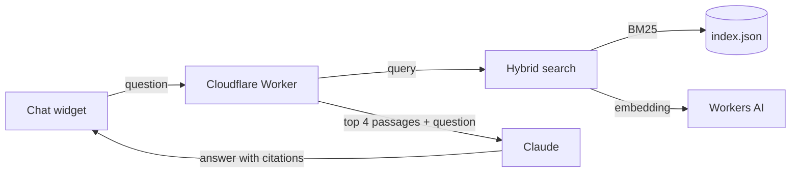

# rag-demo

Ask questions about my CV and projects. A small retrieval-augmented generation (RAG) app on Cloudflare Workers, with Claude writing the answers.

Built to be embedded on [ackeskin.github.io](https://ackeskin.github.io).

## How it works



1. **Index (build time).** `corpus/*.md` is split into one chunk per section. With Cloudflare credentials set, every chunk is embedded with `bge-small-en-v1.5`.
2. **Retrieve.** The Worker scores chunks with BM25 and, when vectors exist, cosine similarity. The two rankings are merged with reciprocal rank fusion. If embedding fails, keyword search still works.
3. **Generate.** The top 4 passages go to Claude with a prompt that says to answer only from them and cite `[n]`.
4. **Show.** The widget renders the answer, turns `[n]` into citation chips and lists the sources.

Without a Worker the widget runs **offline**: the same search runs in the browser and shows the matching passages. It also falls back to offline if the Worker is down or rate limited.

## Cost and abuse controls

| Control | Where |
| --- | --- |
| API key stays in a Worker secret, never in the browser | `wrangler secret put` |
| Requests must come from a listed origin, others get 403 | `ALLOWED_ORIGINS` |
| 10 questions per minute per IP, 40 across all visitors | `[[ratelimits]]` in `wrangler.toml` |
| Questions capped at 300 characters, answers at 400 tokens, 15 s timeout | `src/core/prompt.ts`, `src/worker/handler.ts` |
| No model call when search finds nothing | `src/worker/handler.ts` |
| Monthly spend limit | Set it in the Claude Console |

The origin check only keeps other websites from using the API, since a script can fake the header. The rate limits and the spend limit are what cap the bill. Cloudflare counts rate limits per location, so the global limit is approximate; the spend limit is the hard cap. A question costs well under a cent with a Haiku-class model.

## Run it

Needs Node 22.18 or later.

```sh
npm install
npm run check        # typecheck + tests
npm run build        # dist/widget.js and dist/index.html (offline mode)
```

Local Worker:

```sh
echo "ANTHROPIC_API_KEY=sk-ant-..." > .dev.vars
npm run dev          # http://localhost:8787/api/ask
curl -X POST localhost:8787/api/ask -H 'origin: https://ackeskin.github.io' -H 'content-type: application/json' -d '{"question":"What does he do at Hololight?"}'
```

## Deploy

1. `npx wrangler login`, then `npx wrangler secret put ANTHROPIC_API_KEY`.
2. In the GitHub repo settings add:
   - variable `CLOUDFLARE_ACCOUNT_ID`
   - variable `WORKER_URL` (for example `https://rag-demo.<you>.workers.dev`)
   - secret `CLOUDFLARE_API_TOKEN` with Workers Scripts edit and Workers AI read
3. Set Pages source to GitHub Actions.

Each push to `main` then deploys the Worker (with vectors) and the demo page.

## Embed

```html
<div data-rag-demo data-endpoint="https://rag-demo.<you>.workers.dev"></div>
<script type="module" src="https://ackeskin.github.io/rag-demo/widget.js"></script>
```

The widget uses shadow DOM, so the host page's CSS does not leak in.

## Layout

```
corpus/          Source documents (markdown with front matter)
scripts/         build-index.ts, build-web.ts
src/core/        Chunking, tokenizer, BM25, vector math, hybrid retriever, prompt
src/worker/      Cloudflare Worker: routes, CORS, rate limit, Claude call
src/web/         Chat widget
test/            Vitest tests
```

## API

`POST /api/ask` with `{ "question": string }`

```json
{ "answer": "He leads the shared Unity client [1].", "sources": [{ "n": 1, "title": "Experience", "section": "Hololight, ...", "url": "..." }] }
```

Errors: `400` bad input, `403` origin, `429` rate limited, `502` model unavailable (still includes `sources`).

## License

MIT
